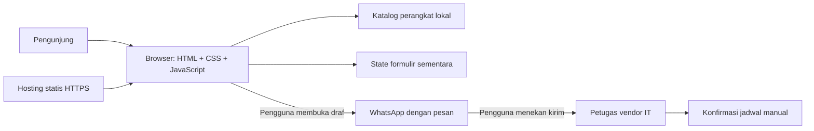

# Arsitektur Sistem — Reservasi Infrastruktur Jaringan

## 1. Bentuk sistem MVP
Website satu halaman berbasis HTML, CSS, dan JavaScript. Pencarian perangkat, validasi formulir, dan pembuatan ringkasan berjalan di browser. Hosting statis mengirimkan aset. Pengajuan dibuka melalui WhatsApp dan dikonfirmasi secara manual oleh vendor IT.



## 2. Struktur berkas yang disarankan
```text
vendor IT-perangkat/sistem/
├── index.html
├── css/styles.css
├── js/
│   ├── config.js       # Identitas vendor IT dan nomor WhatsApp publik
│   ├── data.js         # Katalog perangkat dan informasi statis
│   ├── app.js          # Inisialisasi, render, pencarian, filter
│   ├── form.js         # State dan validasi formulir
│   ├── storage.js      # Penyimpanan preferensi non-sensitif jika diperlukan
│   └── booking.js      # Ringkasan dan pembentukan tautan WhatsApp
├── assets/images/
├── prd.md
├── tech_stack.md
├── arsitektur.md
├── ui.ux.md
├── instruction.md
└── verification.md
```

## 3. Model data konseptual
- `SERVICE`: `id`, `name`, `category`, `description`, `durationMinutes` (opsional), `price` (opsional dan harus diverifikasi), `image`, `imageAlt`.
- `BOOKING_DRAFT`: `serviceId`, `preferredDate`, `preferredTime`, `clientName`, `clientContact`, `systemName`, `deviceType`, `optionalNotes`.
- Data formulir hanya berada di memori halaman sampai pengguna memilih membuka WhatsApp. Jangan menyimpan nama, kontak, atau catatan kesehatan ke localStorage.

Model ini adalah struktur objek frontend, bukan tabel database atau catatan reservasi resmi.

## 4. Alur memuat halaman
1. Muat konfigurasi dan katalog lokal.
2. Render perangkat dan informasi vendor IT yang telah diverifikasi.
3. Tampilkan keadaan kosong/error yang jelas jika data perangkat tidak tersedia.
4. Jangan menampilkan klaim slot tersedia jika tidak ada sistem jadwal bersama.

## 5. Alur pengajuan
1. Validasi perangkat, nama, kontak, data perangkat/sistem minimum, dan tanggal.
2. Pastikan tanggal adalah tanggal kalender nyata dan tidak berada di masa lalu.
3. Tampilkan ringkasan dengan label “permintaan jadwal” dan status belum dikonfirmasi.
4. Bentuk pesan dari state terbaru dan encode menggunakan `encodeURIComponent`.
5. Buka `https://wa.me/<nomor-vendor IT>?text=<pesan>` melalui tindakan pengguna.
6. Jangan mengirim pesan otomatis, mengosongkan formulir seolah berhasil, atau menampilkan status reservasi berhasil.
7. Konfirmasi dilakukan oleh tim support vendor IT di luar website.

## 6. Keamanan dan kegagalan
Gunakan `textContent` atau DOM API untuk data dinamis; hindari memasukkan input pengguna ke `innerHTML`. Jangan mencatat data pemilik atau catatan perangkat ke console. Tangani nomor vendor IT kosong, tanggal invalid, penyimpanan ditolak, dan gambar gagal dimuat. Sertakan `noscript` untuk menjelaskan keterbatasan fitur interaktif.

## 7. Pengembangan lanjutan
Jika diperlukan jadwal real-time, tambahkan backend dan database dengan slot waktu, zona waktu/kalender vendor IT yang jelas, penguncian atau transaksi untuk mencegah bentrok, status reservasi, autentikasi tim support, audit perubahan, serta kebijakan privasi dan retensi data.
